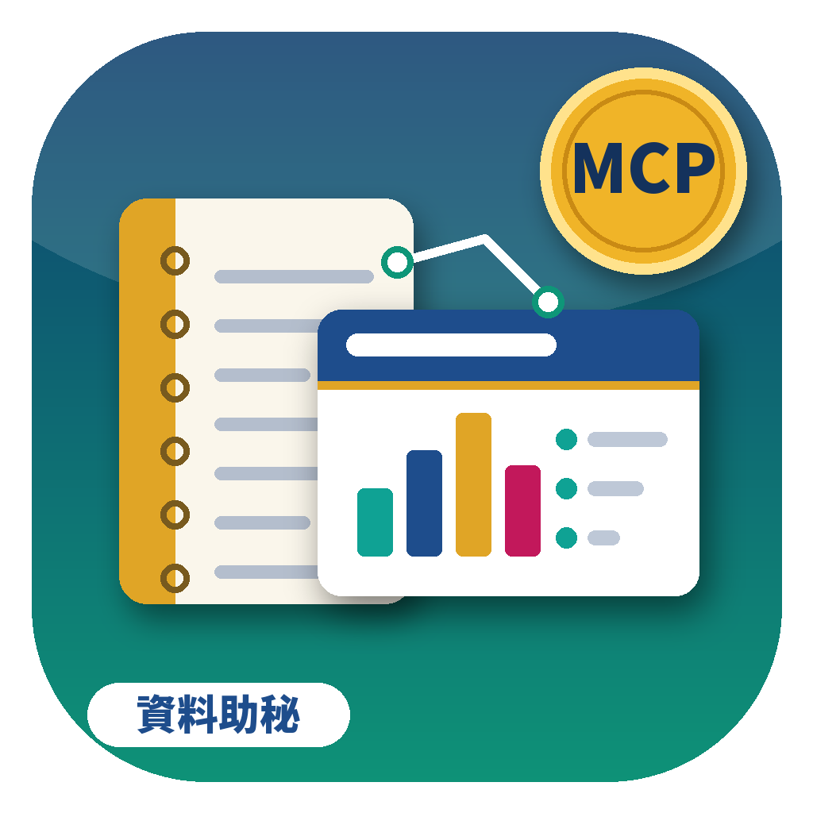

# 資料助秘NotebookLM MCP簡報



說明


https://github.com/user-attachments/assets/b15770d6-6d81-4f42-b89a-bc7418b1796d


選一本 Google NotebookLM（Gemini Notebook）筆記本，就在這個工具裡依照筆記本的來源產生 **簡報、心智圖、報告、測驗、資訊圖表、互動式網頁**，不必到 NotebookLM 官方網頁裡製作。

- 透過 [NotebookLM MCP 伺服器](https://github.com/PleasePrompto/notebooklm-mcp)（MIT，本專案內附修改版）讀取你的筆記本、對筆記本提問並取得引用來源
- 內定範例：**病房助理技術教育外傭實務訓練**（原 [外傭技術教育簡報產生器](https://github.com/achir1015/ward-assistant-portal/tree/main/wa-training)），封面固定格式（標題 45pt／次標題 40pt／小標題 32pt）、10 張以上、Q&A 五題
- 專案範本可以複製後修改，變成其他專案的簡報產生工具
- 內建 MariaDB 資料庫、使用者權限、程式內更新、語音動態教學（臺灣華語自然語音）

## 六種產出

| 產出 | 檔案 |
|---|---|
| 簡報 | PowerPoint（含講者備註）、簡報大綱 Word、Q&A 作答卷 Word、Q&A 解答 Word、網頁、純文字大綱 |
| 心智圖 | PNG、可收合網頁、Markdown、FreeMind .mm（XMind 可匯入） |
| 報告 | Word、Markdown、網頁 |
| 測驗 | 作答卷 Word、解答 Word、線上作答網頁（自動計分） |
| 資訊圖表 | 直式海報 PNG、網頁 |
| 互動式網頁 | 單一 HTML 檔：章節展開、翻牌卡、常見問答、計分小測驗 |

## 簡報風格

- **柔和插畫（活潑，預設）**：奶油底、粉藍配色、Fluent Emoji 3D 小圖示（MIT），依頁型自動換版型（環狀議程、左清單右插圖、錯誤／正確紅綠對照、關鍵詞字卡、重點回顧、Q&A 對話框）；PowerPoint 文字都可以再編輯
- 另有專業商務、科技潮流、3D 立體插畫、溫馨手繪四種配色
- **NotebookLM 官方 AI 插圖版**：選「需求類型 × 23 種風格 × 9 種佈局」產生視覺指令，貼到 NotebookLM Studio 的簡報／資訊圖表（分類參考 Meiko 微課頻道「NotebookLM 資訊圖表 Prompt 生成器」）

## 平台

- [x] Windows 11
- [ ] macOS
- [ ] 線上版（HTML）
- [ ] iPhone／iPad（線上安裝）
- [ ] Android

## 使用方式

1. **NotebookLM 連線** → 按「登入 Google」，在跳出的 Chrome 視窗自己登入（登入資料只存在這台電腦）
2. 按「讀取帳號筆記本」勾選要用的筆記本，或貼上分享網址
3. **產生工具** → 選產出類型、專案範本與主題、人員、對象、依據文件、張數與風格 → 選「依 NotebookLM 筆記本」→ 開始產生
4. **成品庫** → 預覽、逐頁修改 → 匯出

> 注意：NotebookLM 沒有公開的提問 API。Google 官方的 Gemini Notebook MCP（預覽版）目前只能建立筆記本與加入來源，
> 不能提問或產生內容，所以本工具用瀏覽器自動化的 notebooklm-mcp 代為提問。Google 改版時可能需要更新。

## 開發

```powershell
python -m venv .venv
.venv\Scripts\pip install flet==1.1.2 flet-audio==1.1.2 flet-desktop==1.1.2 flet-web==1.1.2 PyMySQL edge-tts python-pptx python-docx pillow qrcode certifi pytest pyinstaller
cd vendor\notebooklm-mcp; npm ci; npx tsc; cd ..\..
.venv\Scripts\python -m pytest -q tests
.venv\Scripts\python run_web.py         # 網頁預覽 http://127.0.0.1:8680
.venv\Scripts\python tools\build_windows.py
```

## 授權

本專案程式：MIT。`vendor/notebooklm-mcp` 為 PleasePrompto/notebooklm-mcp（MIT）的修改版（新網域 notebook.google.com、
回答判斷、讀取帳號筆記本清單）。範例主題內容為通用護理實務，正式授課前請由護理指導員確認。

開發：吳玉柱 先生 與 Claude AI Opus 5.5
